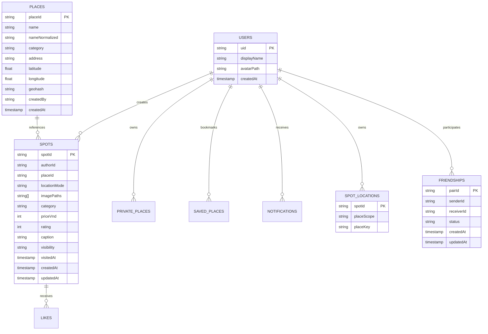

# Kiến Trúc Hệ Thống Rocket24h (ARCHITECTURE.md)

Tài liệu mô tả chi tiết kiến trúc kỹ thuật của hệ thống **Rocket24h (Spot & Place Memory Journal)**.

---

## 1. Phân Tách Lớp Ứng Dụng (Layered Architecture)

Hệ thống được thiết kế theo nguyên tắc phân tách trách nhiệm (Separation of Concerns - SoC):

```
┌─────────────────────────────────────────────────────────────────┐
│                     TẦNG GIAO DIỆN (UI LAYER)                  │
│  - Next.js App Router (app/*, components/*)                     │
│  - Responsive Mobile-first, Tailwind CSS, Leaflet MapProvider    │
│  - Client State, Optimistic UI with Rollback                    │
└────────────────┬────────────────────────────────────────────────┘
                 │
┌────────────────▼────────────────────────────────────────────────┐
│               TẦNG NGHIỆP VỤ & TÍCH HỢP (BUSINESS / DOMAIN)     │
│  - Zod Schemas & Domain Validators (lib/domain/*)               │
│  - Geolocation & Geohash Multi-box Query (lib/geo/*)            │
│  - EXIF Stripper & Image Processing (lib/image/*)               │
└────────────────┬────────────────────────────────────────────────┘
                 │
┌────────────────▼────────────────────────────────────────────────┐
│               TẦNG TRUY CẬP DỮ LIỆU (DATA ACCESS LAYER)         │
│  - Client SDK: Firestore Rules Bound Queries (lib/data/*)       │
│  - Server SDK (Route Handlers): firebase-admin (server/*)       │
└────────────────┬────────────────────────────────────────────────┘
                 │
┌────────────────▼────────────────────────────────────────────────┐
│              TẦNG LƯU TRỮ & AN TOÀN (PERSISTENCE & SECURITY)    │
│  - Firestore: firestore.rules, firestore.indexes.json           │
│  - Storage: storage.rules (MIME, Size, Path Security)           │
│  - Firebase Auth: UID-based Access Tokens                       │
└─────────────────────────────────────────────────────────────────┘
```

---

## 2. Mô Hình Dữ Liệu (Data Model)

Mọi mốc thời gian (`createdAt`, `updatedAt`, `visitedAt`) đều là Firestore `Timestamp`. Tọa độ sử dụng hệ WGS84.



---

## 3. Luồng Tạo Spot (Spot Creation Flow)

```mermaid
sequenceDiagram
    autonumber
    actor User as Người dùng
    participant UI as Giao diện Tạo Spot
    participant Canvas as Client EXIF Stripper
    participant Storage as Firebase Storage
    participant Route as Server Route Handler / Firestore

    User->>UI: 1. Chọn ảnh (1-5 ảnh)
    UI->>Canvas: 2. Xóa EXIF GPS & nén ảnh
    User->>UI: 3. Lấy vị trí GPS / Chọn ghim bản đồ
    UI->>UI: 4. geohashQueryBounds + truy vấn Place gần (150m)
    UI->>User: 5. Gợi ý Place lân cận (hoặc cho tạo Place mới)
    User->>UI: 6. Nhập Giá, Đánh giá, Chú thích, Visibility, LocationMode
    User->>UI: 7. Bấm "Đăng Spot" (Chặn bấm đúp / Idempotent lock)
    UI->>Storage: 8. Upload ảnh (MIME image/*, <= 5MB)
    UI->>Route: 9. Ghi Spot + Cập nhật SavedPlace (hasVisited=true)
    Note over Route: Nếu locationMode='hidden', placeId trong Spot là null;<br/>tham chiếu thật ghi vào users/{uid}/spotLocations/{spotId}
    Route-->>UI: 10. Trả về thành công
    UI-->>User: 11. Chuyển hướng về Feed / Thông báo thành công
```

---

## 4. Ma Trận Đọc Dữ Liệu và Quy Tắc Bảo Mật

| Phạm vi (`visibility`) | Tác giả (`authorId == uid`) | Bạn bè đã chấp nhận (`accepted`) | Thành viên khác | Khách (Chưa đăng nhập) |
|---|---|---|---|---|
| `public` | ✔ Cho phép | ✔ Cho phép | ✔ Cho phép | ✘ Từ chối |
| `friends` | ✔ Cho phép | ✔ Cho phép | ✘ Từ chối | ✘ Từ chối |
| `private` | ✔ Cho phép | ✘ Từ chối | ✘ Từ chối | ✘ Từ chối |

- `users/{uid}/spotLocations/{spotId}`: Chỉ chủ sở hữu (`request.auth.uid == uid`) mới được quyền đọc/ghi.
- `users/{uid}/privatePlaces/{id}`: Chỉ chủ sở hữu mới được quyền đọc/ghi.
- `users/{uid}/friends/{friendUid}`: Chỉ server (Admin SDK) được phép ghi; client chỉ được đọc để kiểm tra danh sách bạn bè.
- `notifications`: Chỉ do server tạo khi có sự kiện kết bạn / like; người nhận chỉ được sửa trường `isRead`.
